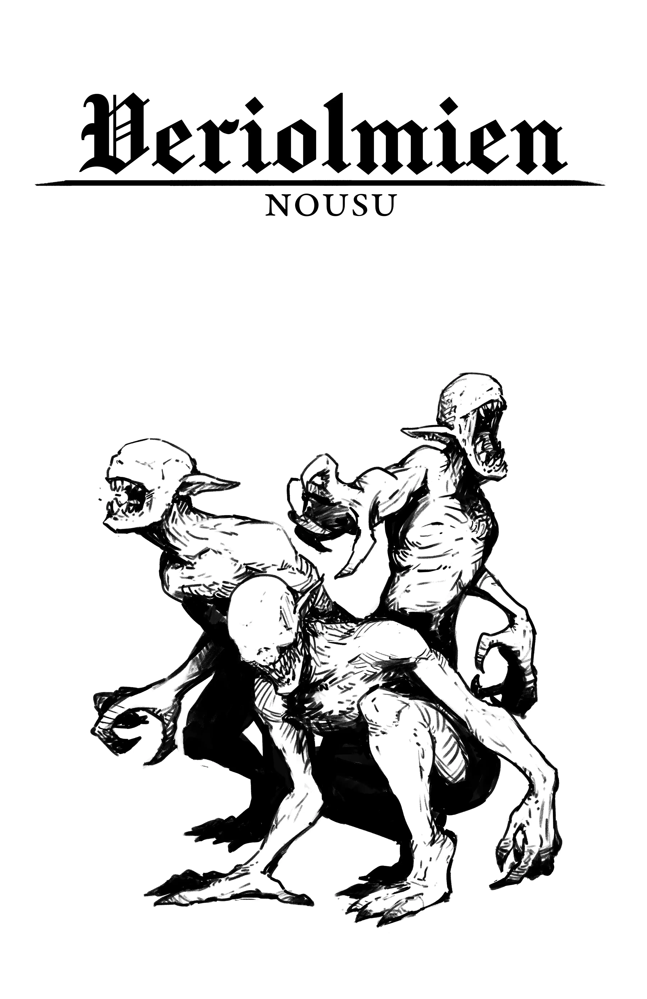
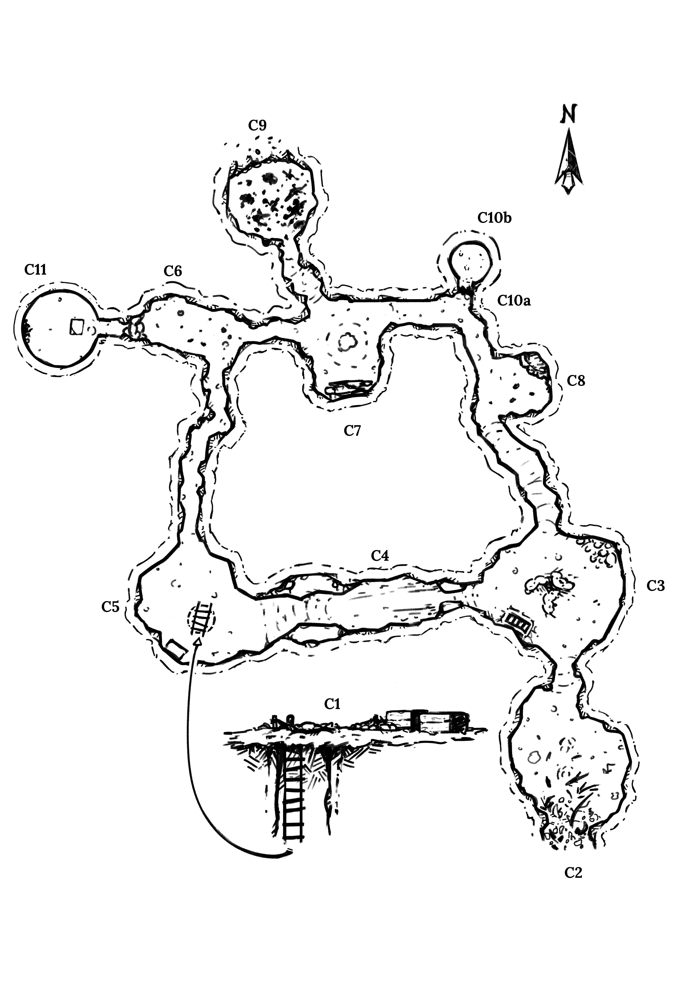
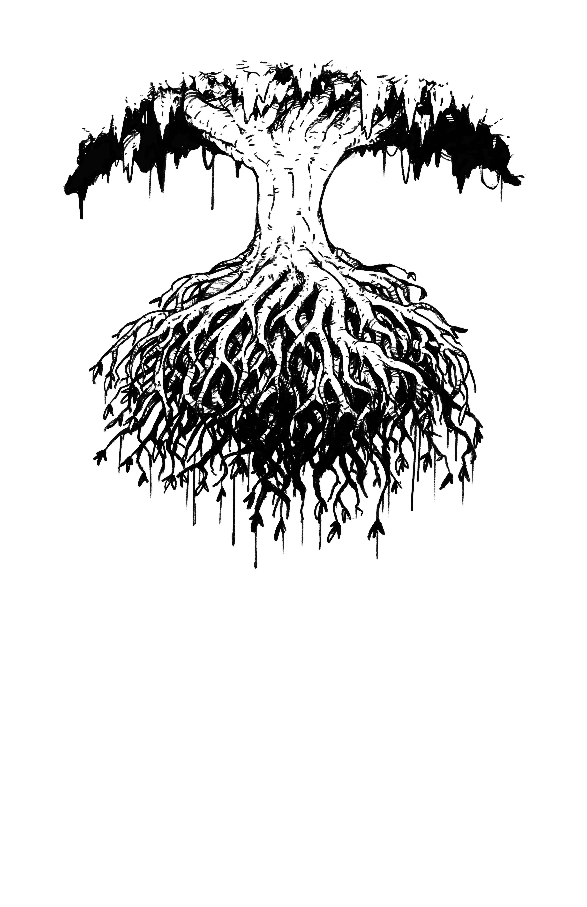
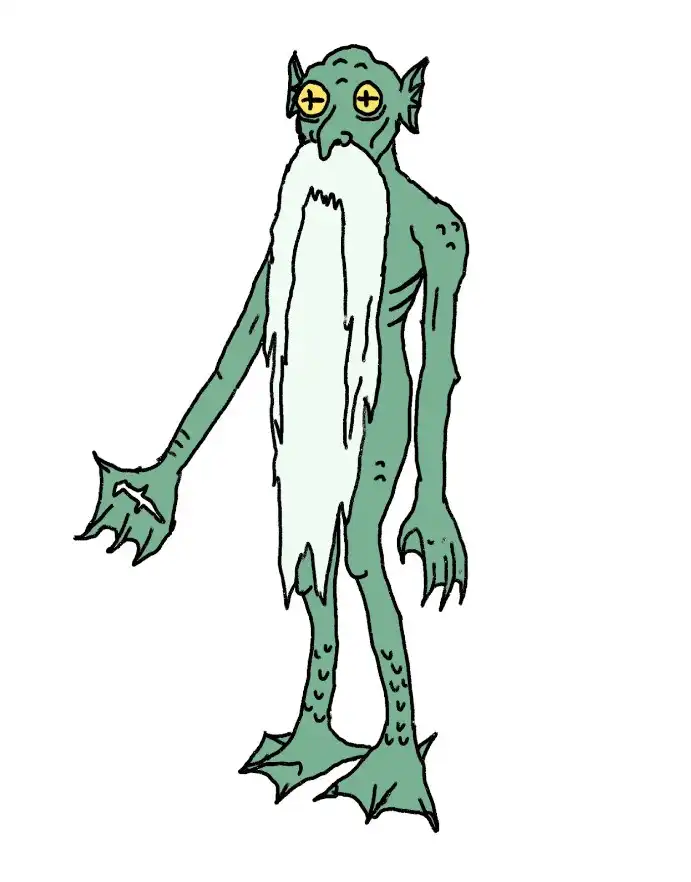

Seuraava seikkailu on saatavilla:

- [Julkaistuna](https://store.cairnrpg.com/products/cas-2-rise-of-the-blood-olms) (englanniksi)
- [PDF-tiedostona](https://yochaigal.itch.io/rise-of-the-blood-olms) (englanniksi, suomennos tulossa)
- Markdown-muodossa (katso alla)

## Tekijät

**Sanat** Yochai Gal, **Toimitus** Derek B., **Kansi- ja karttataide** Ari-Matti Toivonen, **Taitto & Rusal-taide** Adam Hensley. **Suomenkielinen käännös** Kari Silvennoinen. Teksti on CC-BY-SA 4.0 -lisensoitu.

## Tietoja tästä seikkailusta

_CAS-2: Veriolmien nousu_ on aloitusseikkailu, joka on suunniteltu niin uusille kuin kokeneille Vartijoille. Moduuli on tappavan, mutta hahmot kykenevät selviämään hengissä käyttämällä kriittistä ajattelua ja huolellista tutkimista. Jos joku seurueen jäsenistä kuolee, on tärkeämpää, että uusi hahmo liittyy seurueeseen mahdollisimman nopeasti, kuin että pidetään kiinni realismista.

## Periaatteet

- Kun kuvailet huonetta, kertaa aina mitä on aikeissa tapahtua. Näyttääkö tuo liekehtivä tynnyri vakaalta vai siltä, että se saattaa räjähtää?
- Kertaa jatkuvasti mitä hahmon ympärillä on, missä hän on fyysisessä tilassa ja mitä hänen aistinsa havaitsevat. Kuinka lähellä hän on mahdollista vaaraa? Kummalla puolella esinettä hän seisoo?
- Anna vihjeitä siitä, mitä seuraavan käytävän takana odottaa. Onko korkeuseroa? Onko ilman lämpötila erilainen? Onko valaistus, haju tai äänet erilaisia?
- Älä kerro hahmoille, mitä he tuntevat. ”Pitkä, sahalaitainen veitsi” on parempi kuin ”pahalta näyttävä veitsi”.

# Lähtöasetelma

- Kolme viikkoa sitten **Yhdeksän piiri** lähetti **vanhemman lehtori Getelin** johtaman tutkijaryhmän tutkimaan **Hopeasilkkijoen** varrelta äskettäin löydettyä luolastoa. Heitä ei ole kuultu sen jälkeen.
- Piiri on tarjoutunut maksamaan (yhteensä) **1000gp** **[Mutasiivilän](#mutasiivilä)** palauttamisesta vahingoittumattomana. Kyseessä on erittäin arvokas esine, jonka tutkimusryhmä otti mukaansa. Piiri maksaa 100gp lisää jokaisesta retkikunnan neljästä jäsenestä, jotka tuodaan turvallisesti takaisin.
- Seurue kulkee joen vartta pitkin ja saapuu leiripaikan länsipuolelle. Kun pelikerta alkaa, kysy seurueelta, mihin kellonaikaan he toivovat saapuvansa ja millaista säätä he toivoisivat, ja heitä sitten **Kohtalon Noppaa**. Sopeuta heidän ympäristöään tarpeen mukaan.

# Mitä oikeasti on meneillään?

Muutama päivä saapumisensa jälkeen alkuperäinen tutkimusretkikunta löysi **Punaisen erakkopuun** ja sen hedelmien ihmeelliset parantavat ominaisuudet. Jotta puun hedelmien kerääminen olisi helpompaa, he patosivat joen kohdassa **[C9](#c9-veriolmien-pesäpaikka)**. Kun hedelmät oli kerätty, lepakot pakenivat puukodistaan **[C6](#c6-lepakkohuone)**:een, ja olmit jäivät hyvin nälkäisiksi. Jotkut alkoivat syödä **putkimatojen** lihaa, mikä herätti syvällä sisimmässä piilevät lihansyöjävaistot. Sillä välin **vanhempi lehtori Geteli** on tullut hulluksi syötyään putkimadon lihaa, ja paikallinen luolaseikkailija **Jhel-Fries** on linnoittautunut **[C10b](#c10b-suoja)**:hen.

# Vartijan tiedot

## Yhdeksän piiri

Kauppiaiden, oppineiden ja hyvin vaikutusvaltaisten henkilöiden yhteenliittymä, joka luottaa huomattavaan varallisuuteensa ja laajaan vakoiluverkostoonsa saavuttaakseen tavoitteensa. He keskittyvät ensisijaisesti **Porttien** löytämiseen, tunnistamiseen ja sääntelyyn. He uskovat, että **muinaisesineet** ovat lujasti sidoksissa **Juuristoon**, ja ovat valmiita maksamaan runsaasti tiedoista, jotka liittyvät kumpaan vain.

## Retkikunta

- **Vanhempi lehtori Geteli**: Kirjuri. Koppava parhaimpina päivinäänkin. **_ELOSSA_**.
- **Jhel-Fries**: Paikallinen, joka palkattiin luolailukokemuksensa vuoksi. **_ELOSSA_**.
- **Faraj**: Kirjuri ja muinaisesineiden asiantuntija. Piirin jäsen. **_KUOLLUT_**.
- **Oren**: Vaanija ja henkivartija. **_KUOLLUT_**.

## Juuristo

Labyrinttimaiset onkalot ulottuvat mittaamattomien etäisyyksien päähän syvällä maan alla, yhdistäen kaupunkien viemärit kaukaisiin raunioihin. **Juuriston** sisäänkäyntejä (joita kutsutaan **Porteiksi**) sijaitsee ympäri valtakuntaa, mutta ne ovat suojattuja tai taitavasti piilotettuja.

## Hopeasilkkijoki

Kaupunkien tärkein vedenlähde, joka virtaa kapean kanjonin, jota kutsutaan **Sormiksi**, läpi. Viime kuukausina tämä muinainen joki on menettänyt suuren osan vedestään, paljastaen [suuren, sinirenkaisen luolan](#c2-luolan-sisäänkäynti). Tämän seurauksena myös veden korkeus luolassa on laskenut huomattavasti.

## Punainen erakkopuu

Kasvaa ylösalaisin, roikkuen katosta puoliksi veden peitossa olevissa luolissa. Tarvitsee vettä ja metaania selviytyäkseen. Sen kurpitsanmuotoinen hedelmä maistuu aluksi makealta, mutta muuttuu päivän kuluttua ruskeaksi ja haisee mädäntyneeltä. Hedelmä on herkku, ja tuoreena syötynä se voi parantaa haavoja ja elvyttää verenkiertoa (palauttaa 1 STR-pistettä ja poistaa puutostilan, kerran päivässä). **[Sinikidan luolastossa](#sinikidan-luolasto)** kasvava puu on kuolemaisillaan vedenpuutteen vuoksi, mikä johtuu tutkimusretkikunnan rakentamasta väliaikaisesta padosta [C9. Veriolmien pesäpaikassa](#c9-veriolmien-pesäpaikka).

## Olmit

Rauhallisia, sokeita luola-asukkaita. Ne hengittävät ilmaa, mutta osaavat uida ja pidättää hengitystään pitkään. Niillä on erinomainen kuulo, ja ne pystyvät havaitsemaan jopa kaikkein heikoimmat värähtelyt tai lämpötilan muutokset. Ne elävät punaisen erakkopuun hedelmistä ja jokikasveista.

Kun tutkimusretkikunta oli sulkenut veden [C7. Valopihassa](#c7-valopiha), Punainen erakkopuu lakkasi tuottamasta hedelmiä. Ilman niitä Olmit kuolevat. Jotkut ovat jopa alkaneet syödä putkimatoja ja tulleet hulluiksi, muuttuen [veriolmeiksi](#veriolmi).

## Putkimadot

Koiran kokoisia kasvinsyöjiä, joilla on lyhyet, paksut jalat. Ne ovat sokeita, ja niiden päässä on sarvenkaltaiset putket. Kaikki luolan aikuiset ovat jo kuolleet.

# Sinikidan luolasto

## Luolaston yleiskatsaus

- **Sisäänkäynnit**: Ryhmä saapuu [C1. Leiripaikalle](#c1-leiripaikka), joka on suojassa kallionkielekkeen alla. [C2. Luolan sisäänkäynti](#c2-luolan-sisäänkäynti) sijaitsee leiristä alamäkeen, eikä se ole suoraan näkyvissä **C1**:stä.
- **Valo**: Luolissa ei ole luonnonvaloa eikä keinotekoista valonlähdettä.
- **Metaani**: Alueella [C3. Putkimatojen pesä](#c3-putkimatojen-pesä) on näkyvillä metaanin tuuletusaukko. Ilma on erittäin tulenarkaa, ja pitkäaikainen altistuminen sille voi aiheuttaa päänsärkyä ja pahoinvointia (uhrit kärsivät puutostilasta). Kaasu on hajutonta, mutta avotuli välkkyy ja muuttuu siniseksi tuuletusaukon läheisyydessä.
- **Luolaston tapahtumat**: Kohtaamistuloksella ryhmän tulisi kohdata yksi kolmesta veriolmista [C9. Veriolmien pesäpaikasta](#c9-veriolmien-pesäpaikka). Heitä [reaktiotaulukkoa](/second-edition/players-guide/core-rules/#reaktiot).

## C1. Leiripaikka

**Ilma** haisee vahvasti mädäntyneeltä lihalta. Kaksi puista **laatikkoa** seisoo sammuneen **leiritulen** vieressä, ja läheiseen maahan on kaivettu pieni **tunneli**. Leirin itäpäähän on levitetty neljä **huopaa**.

- **Ilma**: Laatikollinen punaisen erakkopuun hedelmiä on hajun lähde.
- **Laatikot**: Kannet ovat siistissä pinossa vieressä, jättäen laatikoiden sisällöt alttiiksi säälle.
  - Yhdessä laatikossa on 1d6 pientä kaivamistyökalua, jotka näyttävät tuoreita ruostumisen merkkejä. Pohjalla oleva hakku (d6) on edelleen hyvässä kunnossa.
  - Toinen laatikko on täynnä punaisen erakkopuun hedelmiä, mutta yhtä lukuun ottamatta ne ovat kaikki mädäntyneet.
- **Tunneli**: Köysitikkaat on kiinnitetty läheisiin kiipeilyhakoihin.
  - Tikkaat ja tunneli [C5. Tikashuoneeseen](#c5-tikashuone) ovat 4 metriä pitkät. Seinät ovat mutaisia ja näyttävät uusilta.
- **Huovat**: Erittäin märät ja homeiset. Yksi niistä on hieman muita pienempi, sillä se kuuluu **Jhel-Friesille ([C10b. Suoja](#c10b-suoja))**.
  - Huopien alla oleva maa on täynnä jalanjälkiä, jotka johtavat itään kohti [C2. Luolan sisäänkäyntiä](#c2-luolan-sisäänkäynti).

## C2. Luolan sisäänkäynti

Luolan suuren pystysuoran **suuaukon** reunalla kasvaa sinistä **sammalta**. Kuollutta **joen kasvillisuutta** ja kiviä on hajallaan ympäriinsä. Luolan **sisäänkäynnin** edessä oleva **maa** on mudan peitossa.

- **Sammal**: Ihan tavallista sinistä sammalta. Kourallinen on arvoltaan noin 10gp Kaupungeissa.
- **Luola**: [C3. Putkimatojen pesästä](#c3-putkimatojen-pesä) vuotava metaanin suhina kuuluu heikosti, mutta vain täydellisessä hiljaisuudessa.
- **Kasvillisuus**: Kuolleet kasvit, simpukankuoret, litteät kivet ja veden uurteet ovat hyviä merkkejä siitä, että tämä alue oli aikoinaan veden alla.
- **Maa**: Länteen päin johtavat mutaiset jalanjäljet vievät ylämäkeen kohti [C1. Leiripaikkaa](#c1-leiripaikka).
- **Sisäänkäynti**: Avotuli alkaa välkkyä sinisenä [C3. Putkimatojen pesän](#c3-putkimatojen-pesä) läheisyydessä.

## C3. Putkimatojen pesä

Huoneen **ilma** on tukahduttavaa. Maassa lojuu kolme lihavaa **madon raatoa**. Munankaltaisia **säkkejä** on kasattu koilliskulmaan. Eteläseinällä **lattiassa** suuri **tuuletusaukko** suhisee äänekkäästi.

- **Ilma**: Mätänevien matojen tuottaman kaasun ja metaanivuotojen yhdistelmä on tehnyt tästä huoneesta räjähdysalttiin. Sisäänkäynti avotulen kanssa aiheuttaa räjähdyksen, joka aiheuttaa d6 STR-vahinkoa kaikille lähistöllä oleville ja tuhoaa liekin lähteen.
- **Raadot**: Niissä on selkeitä puremajälkiä.
- **Säkit**: Kourallinen munia (d6 kappaletta). Jos ne laitetaan veteen, ne kuoriutuvat muutaman päivän kuluessa.
- **Tuuletusaukko**: Erittäin kuuma. Peittämällä se ilma on hengitettävää 1d4 tunnin kuluttua.
- **Lattia**: Tasainen, mutta nousee hieman länsi- ja pohjoisuloskäyntejä kohti. Kaasu nousee kohti [C4. Väijytyshuonetta](#c4-väijytyshuone).

## C4. Väijytyshuone

Kapea käytävä, jossa on korkeat katot ja hiekka**maaperä**. Itäpäässä kahden suuren **kiven** väliin on muodostunut ahdas käytävä. Kattossa on lukuisia **tippukiviä** ja **kielekkeitä**. **Ilma** on täällä raskasta ja epämiellyttävää. Itäinen uloskäynti laskee kohti [C3. Putkimatojen pesää](#c3-putkimatojen-pesä).

- **Maaperä**: Yhdensuuntaiset jäljet osoittavat, että kivet on raahattu nykyisille paikoilleen.
- **Kivet**: Työnnetty paikoilleen, kaventaen kulkua.
  - Ensimmäinen kivien väliin astuva saa osuman tippukivestä, jonka **[Vanhempi lehtori Geteli](#vanhempi-lehtori-geteli)** pudottaa yläpuolella olevalta kielekkeeltä (d8 STR-vahinkoa).
- **Tippukivi**: Puoliksi rikkoutunut, ikään kuin se olisi murskattu. Roikkuu lähellä leveää kielekettä.
- **Kielekkeet**: Pohjoisseinällä on kaksi ulkonevaa kallionkielekettä ja eteläseinällä yksi.
  - Eteläinen kieleke sijaitsee lähellä kattoa, ja sille kiipeäminen vaatii sekä aikaa että vaivaa tai sopivia välineitä.
  - Pohjoisille kielekkeille on helpompi kiivetä. Ylimmältä kielekkeeltä avautuu esteetön näkymä vastapäätä sijaitsevalle korkeammalle eteläiselle kielekkeelle.
  - Alimman kielekkeen valaiseminen paljastaa joukon ihmisen jalanjälkiä.
- **Ilma**: Kaasua [C3. Putkimatojen pesästä](#c3-putkimatojen-pesä) leijuu tähän huoneeseen, aiheuttaen liekkien sinistä välkyntää sytytettäessä.

## C5. Tikashuone

**Köysitikkaat** roikkuvat katossa olevasta aukosta. Lounaisnurkassa on **rautalaatikko**. Kuolleita kaloja törröttää esiin mutaisesta **maasta**, joka kaartuu kohti korkeampaa maastoa itäisen uloskäynnin suunnassa.

- **Köysi**: Tunneli ulos ([C1. Leiripaikka](#c1-leiripaikka)). Tikkaat ja tunneli ovat molemmat 4 metriä pitkiä. Kuten loputkin huoneesta, tunneli on hyvin mutainen ja näyttää juuri kaivetulta.
- **Rautalaatikko**: Kaksi kiipeilyhakaa ja muona-annoksia (2 käyttökertaa jäljellä).
- **Maa**: Huoneen poikki kulkee valkoisia, lepakon ulosteen täplittämiä kengänjälkiä.

## C6. Lepakkohuone

Huone haisee kauhealta, ja **maaperä** on täysin sotkuinen. Ylhäältä, katosta ulkonevien pitkien tippukivipylvien luota, kuuluu korkeita **ääniä**. Länsiseinällä kasvaa suuria valkoisia **sieniä**.

- **Maaperä**: Maa on täynnä lepakon ulostetta ja mädäntyneitä erakkopuun hedelmiä.
  - Valkoisessa tahmassa näkyy räpylämäisiä jalanjälkiä. Niitä on mahdotonta seurata.
- **Äänet**: Satoja lepakoita pesii yläpuolella olevassa katossa, paettuaan [C7. Valopihalta](#c7-valopiha).
- **Sienet**: Kasvavat paksuina ja köysimäisinä, ja niitä voi työntää sivuun. Myrkyllisiä vain syötynä.
  - Peittävät tunnelin [C11. Kaivolle](#c11-kaivo). Se on juuri tarpeeksi leveä, jotta sen läpi voi ryömiä yksitellen ja peräkkäin.

## C7. Valopiha

Katosta roikkuu valtava **puu**, jonka juuret ovat näkyvillä. Alhaalle on kertynyt pieni määrä **vettä**. Eteläisen **seinän** lähellä makaa kaksi **ruumista**, kasvot alaspäin.

- **Puu**: Punainen erakkopuu. Se on kuolemaisillaan vedenpuutteeseen.
  - Jos vesi palaa tähän huoneeseen ja juuret ovat kokonaan veden peitossa, puu selviää ja alkaa tuottaa jälleen hedelmää, ja Olmit [C8. Olmien pesästä](#c8-olmien-pesä) selviävät.
  - Puun ylimmät oksat ovat lepakon ulosteen peitossa. Puu on yleensä täynnä lepakoita, mutta ne ovat kaikki paenneet [C6. Lepakkohuoneeseen](#c6-lepakkohuone) sen jälkeen kun puu lakkasi tuottamasta hedelmiä.
- **Vesi**: Rinteeseen on kaivertunut pieni lammikko. Vettä riittää seurueen varastojen täydentämiseen, mutta ei muuhun. Mätiä hedelmiä kelluu pinnalla.
  - Vesi voidaan palauttaa tuhoamalla pato [C9. Veriolmien pesäpaikasta](#c9-veriolmien-pesäpaikka).
- **Ruumiit**: Mitä **Farajista** ja **Orenista** on jäljellä. Veriolmi on repinyt heidät palasiksi.
  - Näyttävät olleen kuolleenna vähintään kolmen päivän ajan.
  - Kaksikosta suuremmalta (**Oren**) löytyy pieni veitsi (d6), soihtu (1 käyttökerta jäjellä) ja 47gp. Pienemmältä (**Faraj**) löytyy kompassi (55gp) ja tylppä lapio (d6).

## C8. Olmien pesä

Lämmin, ahdas. 10-14 **Olmia** nukkumassa, syömässä, kuiskailemassa. **Seinät** ovat tiivistetystä savesta, ja niihin on maalattu kirkkailla väreillä. Koillispuolella oleva pieni **valli** on täynnä vettä. Huoneessa on erittäin kosteaa ja lämmintä. Lattia on täynnä mädäntyneitä hedelmiä ja ulosteita.

- **Olmit**: Sairaita. Eri kokoisia. Jotkut näyttävät liikkumattomilta.
  - Eivät kiinnitä huomiota pelaajahahmoihin, ellei niillä ole tuoreita hedelmiä mukanaan (ne haistavat ne).
  - Eivät osaa puhua, mutta osoittavat merkkejä korkeasta älykkyydestä.
- **Seinät**:  Täynnä väripyörteitä, jotka on tehty tiivistetystä lepakon ulosteesta ja hedelmistä. Ne kertovat seuraavan tarinan:
  - Olmit (joille on tässä kuvassa piirretty silmät) tulivat vuorilta jokea pitkin ja asettuivat asumaan luoliin.
  - Olmit löysivät hedelmäpuun, ja siitä iloittiin suuresti.
  - Yksi olmi syö putkimadon lihaa, minkä jälkeen sen entinen klaani ajaa sen pois.
- **Valli**: Kirkasta vettä pulppuaa lähteestä, jota ympäröi vyötärönkorkea mutavalli.
  - Lähde on edelleen hyvin elinvoimainen: kalat uivat, kasvillisuus kasvaa ja pohjan metaanilähteistä purkautuu ajoittain lämmintä kaasua. Vesi on juomakelpoista.
  - Jos mutavalli tuhoutuu, lähde tulvii täyttäen [C8. Olmien pesän](#c8-olmien-pesä), [C3. Putkimatojen pesän](#c3-putkimatojen-pesä) ja [C2. Luolan sisäänkäynnin](#c2-luolan-sisäänkäynti), palauttaen osittain elämän luolastoon. Tästä huolimatta, jos vettä ei palauteta Punaiselle erakkopuulle [C7. Valopihalla](#c7-valopiha), nämä olmit tulevat silti kuolemaan.

## C9. Veriolmien pesäpaikka

Vasta tehdy, tiivistyneestä vedestä märät **seinät**. Ruumiita ja **verilöylyn** jälkiä on ympäriinsä. Täällä on kolme **veriolmia**.

- **Seinät**: Näyttävät äskettäin rakennetuilta. Vettä tippuu pohjoispuolella sijaitsevasta padosta.
  - Retkikunta käytti tässä Mutasiivilää tukkimaan maanalaisen joen, jolloin puun vedensaanti katkesi. Jos pato vaurioituu, se murtuu 1d4 minuutin kuluessa täyttäen luolan vedellä (DEX-pelastusheitto, jotta pääsee uiden turvaan).
- **Verilöyly**: Puolen tusinan olmin, putkimadon ja lepakon jäännöksiä.
- **Veriolmit**: Enintään kolme, riippuen siitä, miten ryhmä eteni luolastossa.
  - Jos pelaajahahmot tulivat sisään [C1. Leiripaikan](#c1-leiripaikka) kautta tai aiheuttivat paljon meteliä, veriolmit ovat heränneet ja valppaina. _Heitä [reaktiotaulukkoa](/second-edition/players-guide/core-rules/#reaktiot)_.
  - Jos pelaajahahmot tulivat sisään [C2. Luolan sisäänkäynnin](#c2-luolan-sisäänkäynti) kautta ja kulkivat varovasti luolaston halki, olennot ovat unessa.
  - Veriolmit eivät anna pelaajahahmojen hukuttaa pesäänsä, ja ne hyökkäävät jokaisen padon tuhoamista yrittävän kimppuun.

## C10a. Barrikadi

Tähän huoneeseen johtava käytävä on tukittu lattiasta kattoon **mutaseinällä**. Valkoiset **kengänjäljet** johtavat käytävään.

- **Muta**: Täysin sileää, tiivistynyttä ja kuivunutta mutaa. Läpikaivaminen käsin vie tunnin ja työkaluilla vain pari minuuttia.
- **Kengänjäljet**: Valkoiset, lepakon ulosteista. Johtavat suoraan kohti mutaseinää, aivan kuin sitä ei olisi siinä.
  - Puhuminen äänekkäästi herättää [C10b. Suojan](#c10b-suoja) asukkaan huomion ja hän huutaa huomiota. Mudan takia hänen äänensä kuitenkin vaimenee huomattavasti.

## C10b. Suoja

Pyöreä, seinämät täysin sileät. Nuori, mudantahrima **nainen** kyyristelee maassa ja osoittaa lapiolla sisäänkäyntiä kohti.

- **Nainen**: Jhel-Fries, joka piileskelee sekä veriolmeilta että vanhemmalta lehtorilta Geteliltä.
  - Jos hän on myöntyväinen, hän kertoo seurueelle, että hänen toverinsa piiritti kauhea olento, joka ensin sammutti heidän soihtunsa ja sitten hyökkäsi heidän kimppuunsa. Hän ja **vanhempi lehtori Geteli** piiloutuivat olmien joukkoon [C8. Olmien pesässä](#c8-olmien-pesä), mutta kun Geteli kääntyi häntä vastaan, hän otti Mutasiivilän ja käytti sitä piiloutuakseen [C10a. Barrikadin](#c10a-barrikadi) taakse. Jos häneltä kysytään putkimadoista [C3. Putkimatojen pesästä](#c3-putkimatojen-pesä), hän myöntää, että Geteli todellakin söi niiden lihaa.

## C11. Kaivo

Pieni, pyöreä huone, jonka **seinät** ovat kiveä ja jossa katon sijasta on suuri aukko. **Jätettä** (luita, lasia ja metallia) on kasattu länsipuolelle. Itäpuolella suuri kangasrulla on levitetty kivisen **laatan** päälle. Elleivät lepakot ole lähteneet [C6. Lepakkohuoneesta](#c6-lepakkohuone), [Rusal](#rusal) on täällä.

- **Seinät**: Tämä huone sijaitsee kuivan kaivon pohjalla. Yllä oleva aukko jatkuu 25 metriä ylöspäin, ennen kuin se päättyy mutaiselle kattoon, joka syntyi kaivon romahtaessa vuosikymmeniä sitten.
- **Jätteet**: Vanha metallinen ämpäri, joukko pieniä posliinikuppeja ja ihmisen luuranko.
  - Kupit ovat erinomaisessa kunnossa, mutta silti hyvin hauraita. Ne ovat yhdessä arvoltaan 150gp.
  - Rusal kertoo, että hän löysi luurangon monia vuosia sitten ja päätti pitää sen lähellään, koska hän oli yksinäinen. Hän tulee hyökkäämään sen koskemttamista yrittävän kimppuun.
- **Laatta**: Rusal nukkuu kankaan päällä. Laatta oli aikoinaan osa vanhaa (ja jo kauan sitten tuhoutunutta) kylää, joka käytti tätä kaivoa.

# Rusal

Vihreäihoinen, iäkäs ihmisolento, jolla on pitkä, varpaiden tasalle ylettyvä, valkoinen parta. Hänen sammakkomaiset silmänsä ovat sameat, mutta vilkkaat. Hänen kätensä ja jalkansa ovat räpylämäiset, ja hän on aina alasti.

- Rusal, joen ja luolan henki, on aina asunut näissä luolissa. Hän muutti vanhaan kaivoon vasta sen jälkeen, kun lepakot olivat vallanneet hänen entisen asuinpaikkansa [C6. Lepakkohuoneessa](#c6-lepakkohuone). Hän on syvästi huolissaan luonnon epätasapainosta, mutta ei aio ryhtyä mihinkään toimenpiteisiin Veriolmeja vastaan. "Ne ovat nyt osa uutta tasapainoa."
- Hän on erittäin tyytymätön viimeaikaisiin tapahtumiin. Ensin joki menetti suurimman osan vedestään, sitten tunkeilijat saapuivat ja sekoittivat mutaa ikään kuin se olisi vettä, sitten puu alkoi kuolla, ja lopulta olmit ryhtyivät syömään toisiaan. Koska hänen vanha kotinsa oli peittynyt lepakon ulosteisiin, hän joutui muuttamaan ”vanhaan kaivoon” ([C11. Kaivo](#c11-kaivo)). Jos lepakot saavat palata Valopihalle ([C7. Valopiha](#c7-valopiha)) hän on siitä erittäin kiitollinen ja myöntää **lahjan** yhdelle pelaajahahmolle.
- Muussa tapauksessa hän tarjoaa mielellään vaihtokauppaa pelaajahahmojen kanssa ja lupaa suurta voimaa - tietysti tietystä hinnasta. Hän hyväksyy kuitenkin maksuna vain hämyisiä, abstrakteja käsitteitä: henkilön puhetta, kotimuistoja, kunnianhimoja, naurua jne. Hän rakastaa kaikenlaisten kauppojen tekemistä, ja erityisesti kauppojen sisällä olevia kauppoja.
- Häntä ei voi vahingoittaa millään tavanomaisella tavalla, mutta hän pakenee palavaa tupakkaa tai suitsuketta (hän ei yksinkertaisesti pidä niiden hajusta). Hän kuitenkin todella pitää musiikista ja tanssimisesta.

| **d6** | **Lahja** (Heitä uudelleen, jos tulos on sama tai ei päde.)                                             |
| ------ | ------------------------------------------------------------------------------------------------------- |
| **1**  | Veden hengittäminen. Mitä pidempään vietät aikaa vedessä, sitä enemmän haluat palata sinne.             |
| **2**  | Parantaa sairauden tai vaivan. Heitä STR- tai DEX-arvo uudelleen ja pidä tulos.                         |
| **3**  | Vastaanota suuri kyky, joka on suuren taiteilijan arvoinen. Se ei kuitenkaan tuota sinulle mitään iloa. |
| **4**  | Paina loitsukirja pysyvästi mieleesi (menetät 1d4 WIL-pistettä). Tämä tuhoaa loitsukirjan.              |
| **5**  | Minkä tahansa oven avain, joka toimii vain kerran. Se näyttää kalanruodolta (mitätön).                  |
| **6**  | Voimakkaan salaisuuden takana piilevä tootuus. Vain sinä kuulet tuloksen.                               |

# Sivuhahmojen tiedot

## Vanhempi lehtori Geteli

6 HP, 11 STR, 15 DEX, 17 WIL, terotettu kiipeilyhaka (d6). Pitkä ja ylimielinen Kirjuri, joka on menettänyt järkensä.

- Söi putkimadon lihaa muutama päivä sen jälkeen, kun joki oli padottu [C9. Veriolmien pesäpaikassa](#c9-veriolmien-pesäpaikka). Se ajoi hänet hiljalleen hulluksi, ja hänen silmänsä muuttuivat syvän punaisiksi. Yritti murhata **Jhel-Friesin**, mutta epäonnistui.
- Kantaa mukanaan pientä kääröä (mitätön), jossa selitetään, miten Mutasiivilä toimii. Sivun alareunassa on 3 mustaa merkkiä, jotka osoittavat, kuinka monta latausta muinaisesineellä on, kun se on ladattu.
- Hänet voidaan parantaa vain Kaupungeissa tarjottavan erikoistuneen hoidon avulla. Hän vastustaa kaikkia yrityksiä poistua luolista ja yrittää tappaa jokaisen kohtaamansa elävän olennon.

## Veriolmi

8 HP, 14 STR, 11 DEX, 4 WIL, kynnet (d8+d8)

- Sokeita, lihaaysöviä ihmisolentoja, jotka metsästävät lämpöjäljen avulla. Avoimesti kannibalistisia.
- Välttävät metaanikaasua sisältäviä alueita, ja yrittävät sammuttaa kaikki avotulet.
- **Kriittinen vahinko**: Suuri pala lihaa puraristaan irti (d6 STR-vahinkoa)

## Olmi

2 HP, 8 STR, 6 DEX, 12 WIL, kynnet (d8+d8)

- Kasvissyöjä. Taistelee vain itsepuolustukseksi.

## Jhel-Fries

2 HP, 8 STR, 14 DEX, 11 WIL, lapio (d6)

- Paikallinen tyttö, jolla on kokemusta luolasukelluksesta. Hän on 15-vuotias.
- Hänellä pitää tällä hetkellä hallussaan [Mutasiivilää](#mutasiivilä).

# Muinaisesineet

## Mutasiivilä

Kämmeneen sopiva puolikuun muotoinen kivi. Antaa käyttäjälle kyvyn muovata ja erottaa mutaa aivan kuin se olisi vettä. 3 latausta.

- **Lataus**: Jätä yöksi ja päiväksi raivoisaan jokeen ja nouda sen jälkeen.
